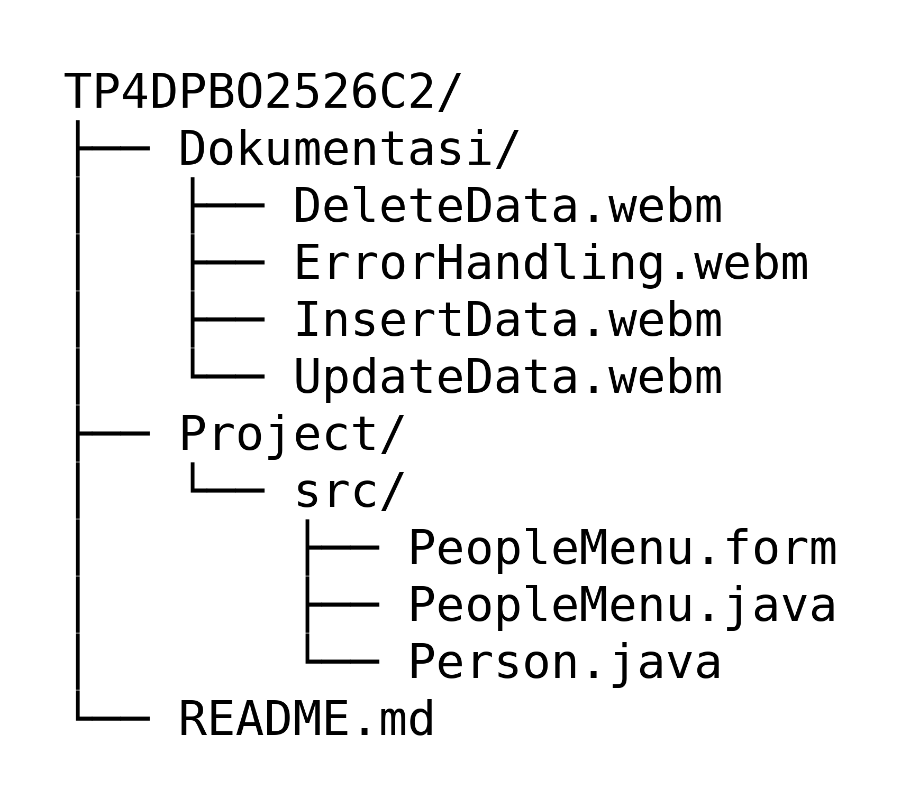

# TP4DPBO2526C2

# janji
Saya Renaldy Heryana dengan NIM 2509867 mengerjakan Tugas Praktikum 4 dalam mata kuliah Desain dan Pemrograman Berorientasi Objek untuk keberkahanNya maka saya tidak melakukan kecurangan seperti yang telah dispesifikasikan. Aamiin.

# STRUKTUR REPO

# DESIGN PROGRAM

# ALUR PROGRAM

1. Program dimulai dengan membuat `listPerson`, lalu mengisinya dengan 12 data awal (P000 sampai P011) lewat `populateList`.
2. Program menampilkan jendela berisi tabel data Person, form isian (Id Karyawan, Nama, Tanggal Lahir, Posisi, dan Jabatan), serta tombol Add, Delete, dan Cancel.
3. Saat belum ada baris yang dipilih (`selectedIndex` bernilai -1), program berada pada mode tambah data. Tombol utama bertuliskan "Add" dan tombol Delete disembunyikan.
4. User menambahkan data dengan mengisi form lalu menekan tombol Add. Data divalidasi terlebih dahulu. Jika valid, Person baru ditambahkan ke `listPerson`, tabel diperbarui, form dikosongkan, dan muncul pesan "Add Data succeed".
5. User mengubah data dengan mengklik salah satu baris di tabel. Data baris tersebut tampil di form, tombol utama berubah menjadi "Update", dan tombol Delete ditampilkan.
6. Setelah isian diubah dan tombol Update ditekan, data divalidasi. Jika valid, Person pada baris terpilih diubah, tabel diperbarui, form dikosongkan, dan muncul pesan "Update Data Succeed".
7. User menghapus data dengan memilih baris lalu menekan tombol Delete. Program menampilkan konfirmasi "are you sure?". Jika user memilih Yes, Person dihapus dari `listPerson`, tabel diperbarui, dan muncul pesan "Delete Data Succeed".
8. Tombol Cancel membatalkan pilihan baris dan mengembalikan form ke mode tambah data.
9. Program terus berjalan sampai jendela ditutup.

# ERROR HANDLING
Error handling saya buat untuk menangani masukan yang salah dari user pada saat menambah dan mengubah data. Validasi dilakukan berurutan dan berhenti pada kesalahan pertama. Saat ada kesalahan, program menampilkan pesan, form dibiarkan terbuka, dan fokus dipindahkan ke isian yang salah agar user cukup memperbaikinya lalu menekan tombol lagi.

1. Jika Id Karyawan tidak diawali huruf "P" (termasuk jika kosong), program menampilkan pesan "id harus di awali dengan P...!!".
2. Jika Id Karyawan sudah dipakai Person lain, program menampilkan pesan "id sudah ada, masukan id lain!!". Pada mode ubah, id milik data yang sedang diedit tidak dianggap duplikat.
3. Jika Posisi masih bernilai "Choose", program menampilkan pesan "pilih posisi dengan benar".
4. Jika Jabatan masih bernilai "Choose", program menampilkan pesan "pilih jabatan dengan benar".
5. Pada penghapusan data, program meminta konfirmasi "are you sure?" terlebih dahulu. Data baru dihapus jika user memilih Yes.

# PENJELASAN ATRIBUT DAN METHOD

Disini adalah penjelasan berbagai atribut dan method dari code yang saya buat dari setiap class

## CLASS Person

Penjelasan atribut dan method dari class Person. Class ini adalah model data yang mewakili satu karyawan.

### ATRIBUT

- id, adalah atribut yang saya buat sebagai kode unik dari karyawan
- nama, adalah atribut untuk mewakili nama dari karyawan
- tanggalLahir, adalah atribut untuk mewakili tanggal lahir dari karyawan
- posisi, adalah atribut untuk mewakili posisi pekerjaan dari karyawan
- jabatan, adalah atribut untuk mewakili jabatan dari karyawan

### METHOD

- Person (tanpa parameter), adalah constructor kosong yang membuat objek Person tanpa mengisi atributnya
- Person (dengan parameter), adalah constructor untuk membuat objek Person sekaligus mengisi id, nama, tanggalLahir, posisi, dan jabatan
- getId dan setId, adalah method untuk mendapatkan (get) dan mengubah (set) nilai id dari kelas ini
- getNama dan setNama, adalah method untuk mendapatkan (get) dan mengubah (set) nilai nama dari kelas ini
- getTanggalLahir dan setTanggalLahir, adalah method untuk mendapatkan (get) dan mengubah (set) nilai tanggalLahir dari kelas ini
- getPosisi dan setPosisi, adalah method untuk mendapatkan (get) dan mengubah (set) nilai posisi dari kelas ini
- getJabatan dan setJabatan, adalah method untuk mendapatkan (get) dan mengubah (set) nilai jabatan dari kelas ini

## CLASS PeopleMenu

Penjelasan atribut dan method dari class PeopleMenu. Class ini turunan dari JFrame dan menjadi jendela utama untuk mengelola data Person lewat form dan tabel.

### ATRIBUT

- listPerson, adalah atribut berupa ArrayList yang menyimpan seluruh objek Person
- selectedIndex, adalah atribut untuk menyimpan indeks baris yang sedang dipilih. Nilai -1 berarti tidak ada baris yang dipilih (mode tambah data)
- idField, namaField, dan tanggalLahirField, adalah atribut berupa kolom isian untuk id, nama, dan tanggal lahir
- posisiComboBox dan jabatanComboBox, adalah atribut berupa pilihan untuk posisi dan jabatan
- personTable, adalah atribut berupa tabel yang menampilkan seluruh data Person
- updateButton, deleteButton, dan cancelButton, adalah atribut berupa tombol untuk tambah atau ubah data, hapus data, dan membatalkan pilihan
- mainPanel dan titleLabel, adalah atribut berupa panel utama dan judul dari jendela

### METHOD

- main, adalah method titik masuk program yang membuat jendela, mengatur ukuran dan posisinya, lalu menampilkannya
- populateList, adalah method untuk mengisi listPerson dengan data awal
- setTable, adalah method untuk membangun TableModel baru dari isi listPerson agar tampilan tabel sinkron dengan data
- clearForm, adalah method untuk mengosongkan form dan mengembalikan program ke mode tambah data
- datachecking, adalah method untuk memeriksa apakah sebuah id sudah dipakai Person lain. Method ini mengembalikan 1 jika id sudah ada dan 0 jika belum
- insertData, adalah method untuk memvalidasi form lalu menambahkan Person baru ke listPerson
- updateData, adalah method untuk memvalidasi form lalu mengubah Person pada baris yang dipilih
- deleteData, adalah method untuk menghapus Person pada baris yang dipilih lalu menyegarkan tabel
- PeopleMenu (constructor), adalah method untuk menyiapkan data awal, isi combo box, tampilan awal, dan seluruh event listener (tombol Add/Update, Delete, Cancel, serta klik pada tabel)

# DOKUMENTASI

Dokumentasi berupa video dari setiap fitur program.

### Tambah data
[InsertData.webm](https://github.com/user-attachments/assets/fba6015c-de9c-4f44-8fb7-a680bbcb148e)

### Ubah data
[UpdateData.webm](https://github.com/user-attachments/assets/f8d6181a-0e5e-4f98-b14b-bea7538ff731)

### Hapus data
[DeleteData.webm](https://github.com/user-attachments/assets/dead92a7-cc58-43ae-ad5d-30004efd1250)

### Error handling
[ErrorHandling.webm](https://github.com/user-attachments/assets/cc9b1260-4aa6-49fd-bbfd-5f87bd0b4746)

